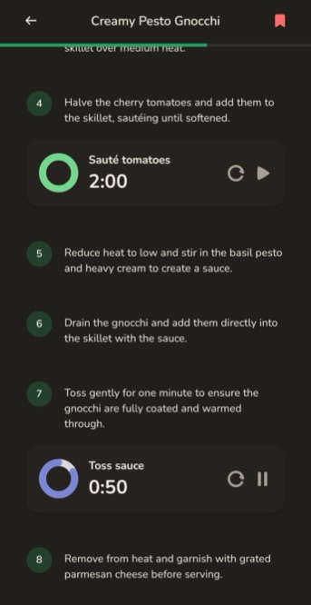
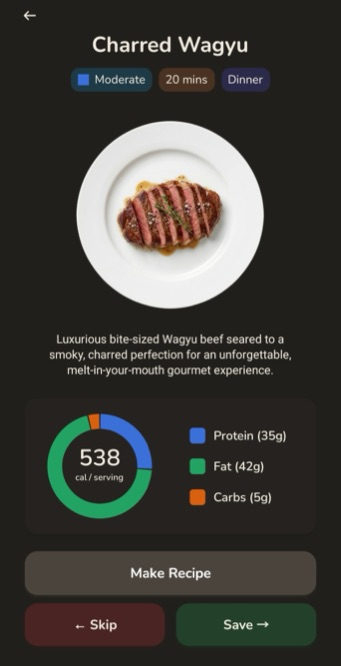
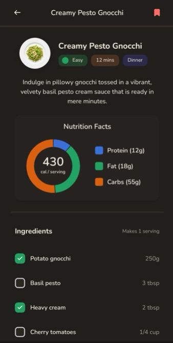
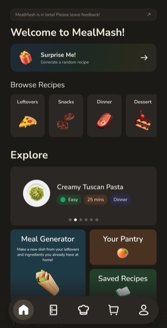
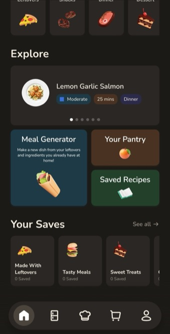
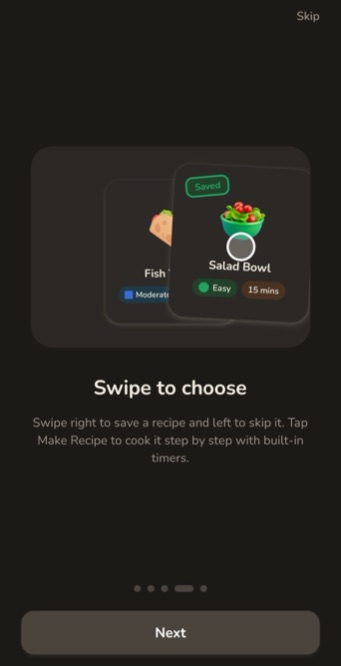
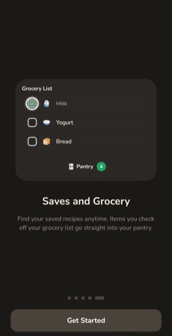

# MealMash

An app that turns whatever that is left in your fridge into a tasty meal. Keep track of your pantry, make grocery lists, swipe through recipes, saving the ones you like, and more

<p align="center">
  
  
  
  
</p>

## Try it out! [linktr.ee/mealmash](https://linktr.ee/mealmash)

- **Android:** download MealMash-1.0.1.apk from [github releases](https://github.com/ashermemon/meal-mash/releases/tag/v1.0.1-beta) and open it on your phone (you have to turn on "allow installing from unknown sources")
- **iOS:** join the [TestFlight beta](https://testflight.apple.com/join/gyUzY9ur)

Follow the tutorial when you first open the app. After that, set up your pantry (fridge tab) and add a few ingredients that you have at home. Then go to the meal generator (chef hat tab) and start swiping through recipes

## Why I made it

I started the project a while back as "Never Leftover". The goal of the project was to address the problem of food being thrown out as often people don't know what to make with the random stuff left in the fridge. Searching up recipes online is boring, tedious, and they often require ingredients you don't have. I wanted an app where you can tell it what you have at home, and swipe through recipes (high dopamine) until you find one you like.

## Features

- **Meal Generator:** make recipes using only your pantry, specific ingredients you pick, or let it use anything. You can also set difficulty, cook time, servings, meal type, cuisine and dietary restrictions
- **Swipe through recipes:** swipe right to save a recipe, swipe left to skip it. Suprise me on the home page gives random recipes (any ingredients)
- **Pantry:** search a big ingredient database and add stuff to your pantry, including leftovers
- **Follow Recipe:** ingredient checklist, nutrition breakdown, step by step instructions and timers
- **Saved Recipes:** auto sorted into categories like Tasty Meals, Sweet Treats, Quick Snacks and Under 15 Minutes
- **Grocery List:** items get added to your pantry when you check them off, and you can uncheck everything to reuse your list
- **Extras:** achievements you can unlock, light and dark mode, and more

<p align="center">
  
  
  
</p>

## Tech Stack

- **TypeScript**
- **React Native + Expo** (Expo Router for navigation)
- **Gemini** for recipe generation
- **Supabase** for the ingredient database and meal images
- **MMKV** for fast local storage
- **Reanimated + Gesture Handler** for the swiping and animations
- **Expo Notifications** for timers and reminders

## Running it locally

You need Node 20+ and Android Studio/Xcode(on Mac). Expo Go will not work as the app uses native modules (MMKV)

```bash
git clone https://github.com/ashermemon/meal-mash.git
cd meal-mash/client
npm install
```

Make a client/.env file with your Gemini API key (free at [Google AI Studio](https://aistudio.google.com/apikey)):

```
EXPO_PUBLIC_API_KEY=put-your-api-key-here
```

Android: you also need a google-services.json from Firebase (for notifications), put it in `client/`

Then run the app:

```bash
npx expo run:android   # or: npx expo run:ios
```

## Attribution

- [MingCute](https://www.mingcute.com/) (App Icons)
- [Gemini](https://ai.google.dev/) and [Supabase](https://supabase.com/)
- [3D Food Icons](https://www.figma.com/design/Xzve0EQketJjhNqtbVL57I/3D-Food-Icons-Free--Community-?node-id=11-11&t=S25RkqStLkoZOEZa-0)
- [More 3D Icons](https://www.figma.com/design/9IZB0gn8Uw6POls2JDM4Zv/Free-3D-Icons--Community-?node-id=0-1&t=Ft7C5jIBzgnlIoXk-0)
- [Even More 3D Icons](https://www.figma.com/design/ZEwJdrT91uyZbhMHq5rdlo/ICON-3D-SET--Community-?node-id=6-4973&t=YcyPjhSK1V4NTb5M-0)
- NO IMAGES OR ASSETS WERE AI GENERATED (ai generated images were removed. none of the assets/icons were ever AI generated)

## Feedback

If you find a bug or have an idea for the app, leave it [here](https://forms.gle/Uxzrkfzvk7tFAFRW9)

Made by Asher Memon
